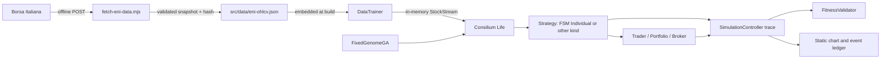
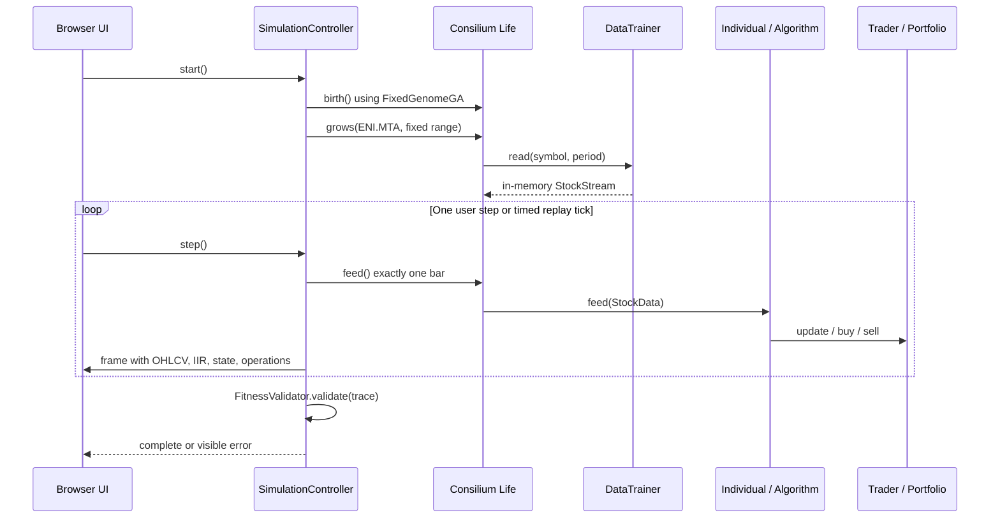

# Simulator Overview

last_verified: 2026-10-12

## Purpose

SwarmTrader replays one immutable Consilium genome over ENI daily OHLCV data through 28/09/2026 inclusive. It is a historical inspection tool, not a trading system or profitability claim.

## Components

- [Data acquisition script](https://github.com/ChaosCoreLab/SwarmTrader-core/blob/main/scripts/fetch-eni-data.mjs) downloads and validates the Borsa Italiana response offline. It writes `src/data/eni-ohlcv.json` atomically with date coverage and SHA-256 metadata; the app imports that file as a JSON module, so it is embedded in the bundle at build time.
- [DataTrainer](https://github.com/ChaosCoreLab/SwarmTrader-core/blob/main/src/engine/dataTrainer.js) validates the snapshot and exposes Consilium `StockStream` objects from memory. It performs no network request.
- [Genome adapter](https://github.com/ChaosCoreLab/SwarmTrader-core/blob/main/src/engine/genome.js) validates the provided snake_case genome and maps percentage fields to the fractional camelCase values expected by Consilium.
- [FixedGenomeGA](https://github.com/ChaosCoreLab/SwarmTrader-core/blob/main/src/engine/fixedGenomeGA.js) supplies exactly one individual, built by a factory; it does not mutate, cross, or evolve the genome.
- [Strategy contract](https://github.com/ChaosCoreLab/SwarmTrader-core/blob/main/src/engine/strategy.js) defines what the engine requires of a genome that plays the replay (see [Strategy contract](#strategy-contract)); `StrategyIndividual` is the base class for kinds other than the state machine.
- [FSM strategy](https://github.com/ChaosCoreLab/SwarmTrader-core/blob/main/src/engine/fsmStrategy.js) presents the Consilium state-machine genome through that contract without changing its trading behaviour.
- [SimulationController](https://github.com/ChaosCoreLab/SwarmTrader-core/blob/main/src/engine/simulationController.js) connects `Life`, `Individual`, and `DataTrainer`, advances one bar at a time, and records the actual state, IIR values, portfolio and broker closes.
- [FitnessValidator](https://github.com/ChaosCoreLab/SwarmTrader-core/blob/main/src/engine/fitnessValidator.js) checks chronological frames, finite IIR values, OHLC/trade coherence, and position quantity invariants. It does not evaluate profitability.
- [Browser UI](https://github.com/ChaosCoreLab/SwarmTrader-core/blob/main/src/main.js) renders candles, volume, IIR, transitions and broker events in a static browser UI.
- `src/vendor/consilium/` contains the selected upstream browser modules at the pinned commit; the MIT license and local browser-only deltas are documented there.

## Strategy contract

The replay engine does not depend on the state-machine genome. It runs any object that `assertStrategy` accepts, in two groups of members:

- **What Consilium's `Life` calls on a child:** `init(stockData)`, `feed(stockData)`, `getCAGR()`, `getPerformanceSummary()`, and the `trader` it trades with; plus `reset()`.
- **What the controller reads for each frame:** `kind` (string), `labels` (the non-empty list of state labels the strategy can report), `describe()` returning `{ label, indicators }` (the current label and a map of named finite numbers) and `serialize()` returning the genome as plain JSON.

Every frame carries `strategy: { kind, label, indicators }` and `state` (the label). For the `fsm` kind the frame also keeps the flat `iirPrice1`, `iirPrice2`, `iirVolume1`, `iirVolume2` fields that the UI and the golden comparison read; other kinds do not have them, so the UI shows state-machine panels only for `fsm` until it is generalised.

`FitnessValidator` takes the strategy's labels, so a label outside the list or a non-finite indicator invalidates the trace. Within one bar it applies buys before closes, because buys fill at the open and stop-loss or take-profit closes happen later in the day, including the close of a position opened on the same bar.

`StrategyIndividual` runs the per-bar order of `Algorithm.feed`: update indicators, let the trader execute the order set on the previous bar, then decide the order for the next bar (`buy`, `sell` or `hold`). A new kind implements `initIndicators`, `updateIndicators`, `resetIndicators`, `decide`, `describe` and `serialize`, and defines `kind` and `labels`. `new SimulationController(snapshot, undefined, { createIndividual })` runs it in place of the fixed state-machine genome. The vendor code under `src/vendor/consilium/` is not modified.

## Data flow

## Replay lifecycle

## Constraints

- The app has no runtime backend; only the data refresh script uses network access.
- Dates are UTC `YYYY-MM-DD`; no bars after 28/09/2026 are admitted.
- The API's observed latest bar on first acquisition was 28/09/2026; the UI reports snapshot coverage rather than synthesizing missing market dates.
- The data file is versioned in Git: the Owner confirmed on 29/09/2026 that Borsa Italiana terms permit its reuse.
- The vendor fork removes only the disabled low-cap profile URL and unused Node `fs`/`path` plus `csvLoader` imports. Trading and Portfolio code remains upstream.